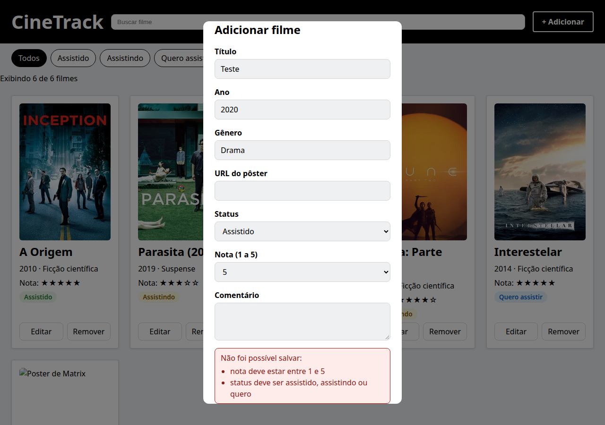

# Testes da Parte 2 (Marco 2)

Teste ponta a ponta do CineTrack full stack a partir de um clone limpo, seguindo o roteiro da ANP 10, e
testes da API com cliente HTTP depois do endurecimento da validação.

## Como foi executado

- **Versão testada:** commit `5233e36` (`feat: mostrar erros de validacao da API no modal`). Os commits
  seguintes só mexem em `docs/` e no `README.md`.
- **Ponto de partida:** `git clone` do repositório para uma pasta nova e vazia, sem `node_modules`, sem `.env`.
- **Ambiente:** Linux (Fedora 43), Node.js v22.22.2, npm 10.9.7.
- **Interface:** Chromium headless (Playwright), janela de 1280x900. O roteiro digita e clica como um usuário
  e lê o DOM. Os `confirm()` de remoção foram respondidos pelo roteiro (cancelar ou confirmar).
- **Cliente HTTP:** `curl`, contra o mesmo backend, depois do teste pela interface.

## Teste ponta a ponta

| # | Passo | Resultado esperado | Resultado obtido | Passou? |
|---|-------|--------------------|------------------|---------|
| 1 | `git clone` do repositório | Projeto completo, sem dependências instaladas | Pastas `backend/`, `docs/`, `exercicios/`, `frontend/`, `parte1/` e `README.md`; HEAD em `5233e36` | Passou |
| 2 | `cd backend`, `npm install`, `cp .env.example .env`, `node seed.js` | Dependências instaladas e 6 filmes gravados | `found 0 vulnerabilities`; `6 filmes gravados`; `data/filmes.json` com A Origem, Parasita, O Auto da Compadecida, Duna: Parte Dois, Interestelar e Cidade de Deus | Passou |
| 3 | Subir o backend: `npm start` | API na porta 3000 | `API na porta 3000`; `GET /` devolveu `{"ola":"CineTrack"}` | Passou |
| 4 | Subir o frontend: `cd frontend`, `npm install`, `npm run dev` | Vite em `http://localhost:5173` | `VITE v8.3.4 ready in 722 ms`, `Local: http://localhost:5173/`; a página respondeu 200 | Passou |
| 5 | Abrir `http://localhost:5173` | Os 6 filmes do seed, vindos da API | 6 cards, na ordem do seed; contador "Exibindo 6 de 6 filmes" | Passou |
| 6 | **Criar:** "+ Adicionar", Matrix, 1999, Ficção científica, Assistido, nota 5, Salvar | O card aparece e o modal fecha | 7 cards, modal fechado; `GET /filmes` já lista "Matrix" (recebeu `id` 7) | Passou |
| 7 | **Editar:** "Editar" no card de Parasita, título "Parasita (2019)", status Assistindo, nota 3, Salvar | O card certo muda, sem duplicar | Modal abriu como "Editar filme" com "Parasita" no campo. Depois de salvar: 7 cards, card "Parasita (2019) · 2019 · Suspense · Nota: ★★★☆☆ · Assistindo". `GET /filmes/2` devolveu o filme com `nota: 3`, `status: "assistindo"` e o comentário e o pôster preservados | Passou |
| 8 | **Remover:** "Remover" em Cidade de Deus, cancelar; depois remover e confirmar | Cancelar mantém; confirmar remove | `confirm("Remover este filme?")` exibido. Cancelado: 7 cards. Confirmado: 6 cards, e `GET /filmes` sem "Cidade de Deus" | Passou |
| 9 | **Erro do servidor pela interface:** "+ Adicionar" com título `"   "` (só espaços), ano 2001, gênero Drama | A API recusa e a interface explica o motivo | O `required` do campo aceita espaços, então a requisição saiu e voltou `400`. O modal continuou aberto com a caixa "Não foi possível salvar: • titulo é obrigatório". 6 cards, nada gravado | Passou |
| 10 | **Cliente adulterado:** pelo DevTools, troquei o `value` das opções de nota (5 → 7) e status (assistido → talvez) e salvei | `400` com os dois erros, mostrados ao usuário | Caixa "Não foi possível salvar: • nota deve estar entre 1 e 5 • status deve ser assistido, assistindo ou quero" (print abaixo). 6 cards, 6 filmes na API | Passou |
| 11 | **Parar o servidor** (Ctrl+C no `npm start`) e olhar `data/filmes.json` | O arquivo já tem as alterações | O processo saiu com código 130 (SIGINT). O arquivo tinha 6 filmes: A Origem, Parasita (2019) (nota 3, assistindo), O Auto da Compadecida, Duna: Parte Dois, Interestelar e Matrix (`id` 7); sem Cidade de Deus | Passou |
| 12 | **Reiniciar** com `npm start` e recarregar a página | Os dados persistem | `API na porta 3000`. A página recarregada mostrou os mesmos 6 cards (A Origem, Parasita (2019), O Auto da Compadecida, Duna: Parte Dois, Interestelar, Matrix), "Exibindo 6 de 6 filmes"; Parasita (2019) continua com ★★★☆☆ e Assistindo | Passou |

Estado de erro do passo 10, como o usuário vê:

## Validação com cliente HTTP

Requisições com `curl` contra o backend do clone (`-H "Content-Type: application/json"` em todas com corpo).
O filme 8 foi criado pelo próprio teste e removido no fim.

| # | Requisição | Esperado | Obtido | Passou? |
|---|------------|----------|--------|---------|
| 1 | `POST /filmes` com `{"titulo":"Tenet","ano":2020,"genero":"Ação","nota":7,"status":"talvez"}` | 400 com os dois erros | **400** `{"erros":["nota deve estar entre 1 e 5","status deve ser assistido, assistindo ou quero"]}` | Passou |
| 2 | `POST /filmes` com `{}` | 400 com os quatro erros | **400** `{"erros":["titulo é obrigatório","ano deve estar entre 1888 e 2030","nota deve estar entre 1 e 5","status deve ser assistido, assistindo ou quero"]}` | Passou |
| 3 | `POST /filmes` sem `Content-Type: application/json` (corpo `titulo=x`) | 400, não 500 | **400** com os mesmos quatro erros (o Express 5 deixa `req.body` indefinido, e a validação trata isso) | Passou |
| 4 | `POST /filmes` com JSON malformado (`{"titulo":`) | 400 | **400** (resposta do `express.json()`) | Passou |
| 5 | `POST /filmes` válido (Tenet, 2020, nota 4, `quero`) | 201 com o filme e `id` | **201** `{"titulo":"Tenet","ano":2020,"genero":"Ação","nota":4,"status":"quero","comentario":"","poster":"","id":8}` | Passou |
| 6 | `PUT /filmes/8` com nota 0 e status `visto` | 400 com os dois erros (mesma validação do POST) | **400** `{"erros":["nota deve estar entre 1 e 5","status deve ser assistido, assistindo ou quero"]}` | Passou |
| 7 | `PUT /filmes/8` só com `{"nota":5}` | 400: o PUT exige o filme completo | **400** `{"erros":["titulo é obrigatório","ano deve estar entre 1888 e 2030","status deve ser assistido, assistindo ou quero"]}` | Passou |
| 8 | `PUT /filmes/8` válido (nota 5, `assistido`) | 200 com o filme atualizado | **200** `{..."nota":5,"status":"assistido",...,"id":8}` | Passou |
| 9 | `PUT /filmes/999` válido | 404 | **404** `{"erro":"Filme não encontrado"}` | Passou |
| 10 | `GET /filmes/8` | 200 com a versão atualizada | **200** `{"titulo":"Tenet",...,"nota":5,"status":"assistido",...,"id":8}` | Passou |
| 11 | `GET /filmes/999` | 404 | **404** `{"erro":"Filme não encontrado"}` | Passou |
| 12 | `GET /filmes?status=assistido&q=a` | 200 | **200** | Passou |
| 13 | `GET /stats` | 200 com total, contagem por status e média | **200** `{"total":7,"porStatus":{"assistido":4,"assistindo":2,"quero":1},"mediaNotas":4.6}` | Passou |
| 14 | `DELETE /filmes/8` | 204 sem corpo | **204** | Passou |
| 15 | `DELETE /filmes/8` de novo | 404 | **404** `{"erro":"Filme não encontrado"}` | Passou |
| 16 | `GET /` | 200 | **200** `{"ola":"CineTrack"}` | Passou |

## Observações

- **Antes desta ANP**, o `POST` com nota 7 e status inventado devolvia 201 e gravava o filme; o `PUT` não
  validava nada; e o frontend mostrava só `alert("Não foi possível salvar: HTTP 400")`. Agora o `api.js` lê a
  lista `erros` da resposta e o modal mostra cada problema, sem fechar e sem perder o que foi digitado.
- **Backend fora do ar:** em vez de "Failed to fetch", a tela mostra "Erro: Não foi possível conectar à API.
  O backend está rodando?".
- **Console do navegador:** nos passos 9 e 10 o Chromium registra
  `Failed to load resource: the server responded with a status of 400`. É o log padrão do navegador para
  respostas 4xx, não um erro do app.
- **Pôster vazio (limitação conhecida, fora do escopo desta ANP):** o card de "Matrix", criado sem URL de
  pôster, mostra o texto alternativo "Poster de Matrix" no lugar da imagem. O `CardFilme` do React não tem a
  imagem reserva que a Parte 1 usava.

## Resumo

- Ponta a ponta: 12 passos a partir de um clone limpo (seed, backend, frontend, CRUD pela interface, erros,
  reinício), todos passaram. Os dados persistiram depois de reiniciar o servidor.
- Cliente HTTP: 16 requisições cobrindo todas as rotas e os códigos 200, 201, 204, 400 e 404, todas com o
  resultado esperado.
